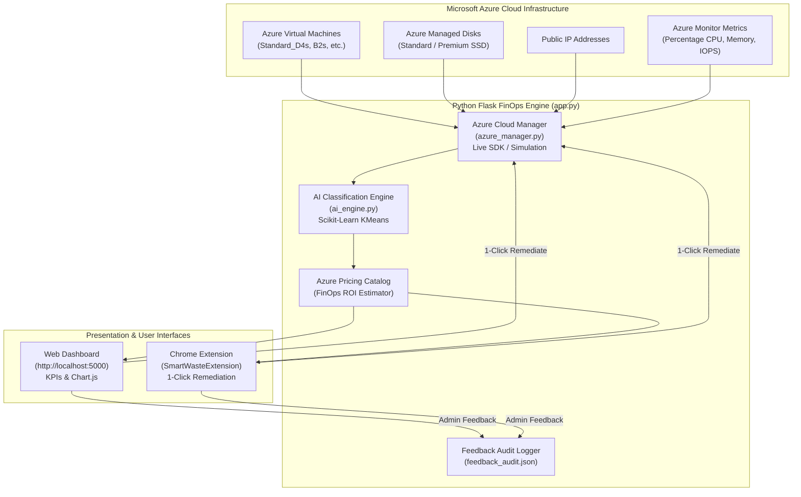

# AI-Powered Cloud Waste Segregation System (Microsoft Azure Edition)

> **Autonomous Cloud FinOps, Telemetry Analyzer & AI-Driven Waste Remediator**  
> *Developed for Woxsen University &bull; Presented by Chiranjeevi M, Pranav Reddy A, Shivamani G*

---

## 📌 Executive Summary

Cloud infrastructure frequently accumulates **unused or underutilized cloud resources ("cloud waste")**—such as zombie VMs running 24/7 with zero traffic, overprovisioned compute instances, and unattached storage volumes. This waste escalates monthly cloud bills by **30% to 50%** and leads to unnecessary energy consumption.

The **AI-Powered Cloud Waste Segregation System** autonomously scans cloud assets across **Microsoft Azure**, applies **Unsupervised Machine Learning (K-Means Clustering)** and multi-variable heuristic scoring to classify resources into distinct waste categories, and provides automated one-click remediation actions (*Deallocate*, *Resize*, *Delete*).

---

## 🏗️ System Architecture



---

## ⚡ Key Segregation Categories & Remediation Actions

| Segregation Category | Criteria | AI Recommendation | Financial Impact |
| :--- | :--- | :--- | :--- |
| 🔴 **IDLE_WASTE (Zombie)** | CPU < 5%, RAM < 10% | **DEALLOCATE** | Eliminates 100% of compute billing ($0.00/mo) |
| 🟠 **OVERPROVISIONED** | 5% $\le$ CPU < 25% on high SKU | **RESIZE to `Standard_B2s`** | Reduces compute bill by ~60% to 80% |
| 🟣 **ORPHANED_STORAGE** | Unattached Managed Disk / IP | **DELETE** | Eliminates idle storage waste |
| 🟢 **OPTIMAL (Critical)** | Healthy utilization (> 40% CPU) | **RETAIN** | Preserves production workload SLAs |

---

## 🚀 Quick Start Guide

### 1. Prerequisites
Ensure you have Python 3.10+ installed:
```bash
python3 --version
```

### 2. Navigate to Project
```bash
cd "/Users/chiranjeevi/Desktop/WOXSEN /Projects/AI_Cloud_Waste_Extension"
```

### 3. Start the Backend Server
```bash
python3 app.py
```
The server will start on: **`http://localhost:5001`** *(Port 5001 is used by default on macOS to avoid port 5000 AirPlay Receiver conflicts)*.

### 4. Access the Web Dashboard
Open your browser and navigate to:
👉 **[http://localhost:5001](http://localhost:5001)**

You will see:
- Real-time Microsoft Azure connection status pill.
- Live executive KPI cards: Monthly Spend, Potential Monthly Savings, Identified Waste %, Health Score.
- Interactive Chart.js graphs: Waste breakdown doughnut and 6-month historical FinOps savings trend.
- Full resource table with individual **Deallocate**, **Resize**, and **Delete** action triggers.
- **"Optimize All Waste"** button for instant bulk remediation.

---

## 🧩 Installing the Chrome Extension

1. Open Google Chrome and navigate to: `chrome://extensions/`
2. Enable **"Developer mode"** (toggle in the top-right corner).
3. Click **"Load unpacked"**.
4. Select the folder:
   `/Users/chiranjeevi/Desktop/WOXSEN /Projects/LAUNCHED/SmartWasteExtension`
5. Click on the extension icon in Chrome's toolbar to open the **Azure Waste Segregator popup**.
6. Click **"Scan Azure Resources"** to see live metrics and trigger 1-click remediation directly from your browser!

---

## ☁️ Connecting to Live Microsoft Azure

By default, the system runs in **High-Fidelity Azure Simulation Mode** with realistic Azure enterprise resources (`Standard_D4s_v5`, `Standard_D8s_v5`, `Standard_E4s_v5`, `Standard_B2s` in regions like `eastus`, `centralindia`, `westeurope`).

To connect to your **live Microsoft Azure Cloud account**:
1. Copy `.env.example` to `.env`:
   ```bash
   cp .env.example .env
   ```
2. Fill in your Azure Service Principal credentials:
   ```env
   AZURE_SUBSCRIPTION_ID="your-subscription-id"
   AZURE_TENANT_ID="your-tenant-id"
   AZURE_CLIENT_ID="your-app-client-id"
   AZURE_CLIENT_SECRET="your-client-secret"
   AZURE_RESOURCE_GROUP="your-resource-group"
   ```
3. Install Azure SDK packages (optional):
   ```bash
   pip install azure-identity azure-mgmt-compute azure-mgmt-monitor
   ```
4. Restart `app.py`. The system will automatically detect the credentials and switch the badge to **"Live Azure Cloud Connected"**.

---

## 🧪 Automated System Verification

To run the automated end-to-end verification test suite:
```bash
python3 test_system.py
```
Outputs test confirmation for Azure telemetry fetching, AI KMeans segregation, and all Flask REST endpoints.
